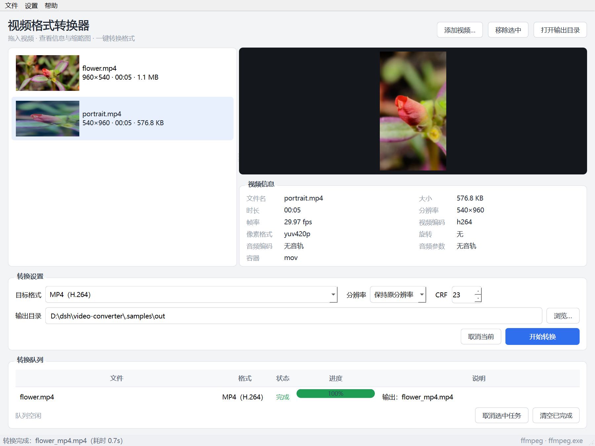
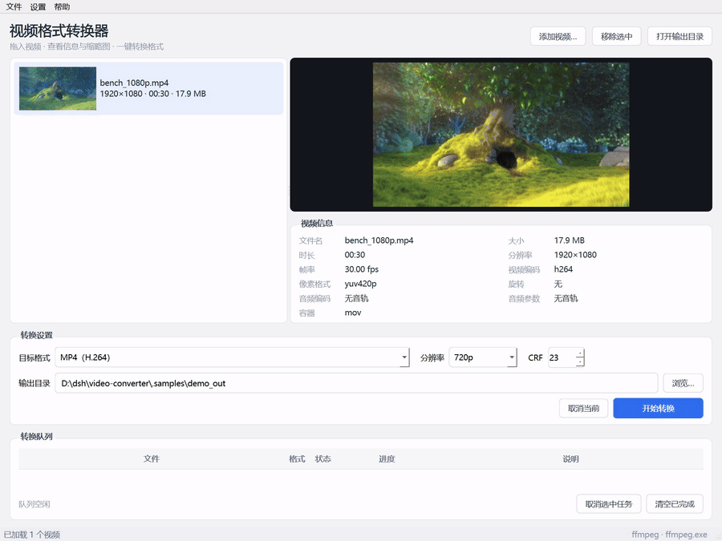

# 视频格式转换器（Video Converter）

Windows 桌面客户端：**PySide6 + 本地 ffmpeg CLI**。拖入视频即可查看信息与缩略图，
按预设转成 MP4 / MKV / WebM / GIF / MP3，支持队列、进度、取消与中文错误提示。

仓库：https://github.com/qianqianying27/video-converter

[](https://github.com/qianqianying27/video-converter/actions/workflows/ci.yml)
[](https://github.com/qianqianying27/video-converter/releases)

## 评审快速体验（推荐）

到 [Releases](https://github.com/qianqianying27/video-converter/releases) 下载
`VideoConverter-1.0.0-win64.zip`，解压后双击 `VideoConverter.exe`。
包内已带 `ffmpeg.exe` / `ffprobe.exe`，**无需安装 Python、无需配置 ffmpeg**。


<p align="center">
  
</p>

真实转换过程录屏（1080p → MP4 720p，约 10 秒，含进度/速度/剩余时间）：



## 功能

| 功能 | 说明 |
| --- | --- |
| 视频信息 | 容器、时长、分辨率、帧率、视频/音频编码、像素格式、旋转、码率、大小（ffprobe） |
| 缩略图 | 后台线程抽帧，按 10% → 50% → 首帧回退；全部失败显示占位图，不阻塞界面 |
| 转换预设 | MP4（H.264）、MKV（`-c copy` 无损换封装）、WebM（VP9）、GIF、MP3 |
| 参数 | 分辨率（1080p / 720p / 480p / 360p / 原分辨率）、CRF 质量 |
| 进度与取消 | 解析 `-progress pipe:1`，显示百分比、速度、剩余时间；取消会 kill 进程并删除半成品 |
| 队列 | 多文件顺序转换，状态：等待中 / 转换中 / 完成 / 失败 / 已取消；失败给中文原因 |
| 体验 | 整窗拖拽、空状态引导、记住窗口几何与上次设置、内置 ffmpeg 优先、可手动指定 |

## 量化优化：无损换封装到底快多少

同一份 **30 秒 / 1080p / H.264** 源文件（本机实测，Windows 11）：

| 输出 | 命令 | 耗时 |
| --- | --- | --- |
| MKV（无损换封装） | `-c copy` | **0.10 s** |
| MP4（H.264，preset medium，CRF 23） | 重编码 | **8.67 s** |

**约 87× 差距**，且换封装不损失画质。适合「只换容器、不想重编码」的场景。

其他实现层面的优化：

- 缩略图 `-ss` 前置快速 seek，10%/50%/首帧三级回退，按「路径 + mtime」缓存；
- 进度解析对 `out_time_us / out_time_ms / out_time` 三级容错，`-c copy` 场景也不会卡在 0%；
- 取消时 kill 进程并删除半成品，避免误判成功与 `_2/_3` 垃圾文件；
- 队列串行执行，避免多个 ffmpeg 抢 CPU 导致「每个都变慢」。

## 从源码运行

```powershell
# 1. 获取 ffmpeg / ffprobe 到 bin\（约 190MB）
powershell -ExecutionPolicy Bypass -File scripts\fetch_ffmpeg.ps1

# 2. 安装依赖
python -m venv .venv
.venv\Scripts\python -m pip install -r requirements.txt

# 3. 启动
.venv\Scripts\python run.py

# 4. 测试（36 项）
.venv\Scripts\python -m pytest -q

# 5. 打包（生成 dist\VideoConverter）
powershell -ExecutionPolicy Bypass -File scripts\build.ps1
```

没有 ffmpeg 时程序会弹出提示，也可以直接选择已有的 `ffmpeg.exe`；
本机已安装 ffmpeg 并加入 PATH 时可跳过第 1 步。

## 界面与交互

- 页头、空状态引导、两列信息布局、深色预览卡片；
- 队列进度条按状态变色（转换中蓝 / 完成绿 / 失败红），状态与设置严格同步；
- 支持把文件拖到窗口任意位置；`Ctrl+O` 添加、`Delete` 移除。

截图由 `scripts/screenshot.py` 真实跑一次 MP4 转换后生成（横屏 + 竖屏各一张）。
示例素材（仅本地，不入库）用 `scripts/fetch_samples.ps1` 获取。

## 目录结构

```
video-converter/
├─ app/
│  ├─ env.py            # ffmpeg/ffprobe 定位、子进程封装（Windows 无黑框）
│  ├─ media_info.py     # ffprobe 解析 + 展示格式化
│  ├─ thumbnail.py      # 多时间点抽帧回退 + 缓存
│  ├─ presets.py        # 预设与 ffmpeg 参数构建（纯函数，可单测）
│  ├─ progress.py       # -progress 输出解析
│  ├─ converter.py      # 单任务 QProcess（异步 / 取消 / 清理半成品）
│  ├─ queue.py          # 顺序转换队列
│  ├─ settings.py       # QSettings 封装
│  ├─ ui/               # 主窗口 + 后台加载任务
│  └─ main.py           # 入口（缺少 ffmpeg 时引导定位）
├─ bin/                 # ffmpeg.exe / ffprobe.exe（不入库，脚本获取）
├─ tests/               # 单元 + 集成 + GUI/队列
├─ scripts/             # fetch_ffmpeg / fetch_samples / build / screenshot / make_test_video
└─ docs/                # 截图、决策记录
```

## 测试

36 项全部通过：单元（进度解析 / 参数构建 / ffprobe JSON）、集成（生成测试视频后真实探测、
抽帧、转 WebM、缩放、抽 MP3、GIF、MKV copy 校验编码未变）、GUI/队列（构造窗口、
添加文件→缩略图→点击转换→完成、队列成功/失败）。

## 第三方组件与许可

见 [THIRD_PARTY_NOTICES.md](THIRD_PARTY_NOTICES.md)。要点：

- **FFmpeg / ffprobe**：BtbN 的 GPL 构建，以**独立可执行文件**形式随 Release 分发，
  应用通过命令行调用，未链接进本体代码；FFmpeg 为 LGPL/GPL（因启用 libx264 等 GPL 组件）。
  商用再分发前请按 GPL 要求附带许可证与源码获取方式。
- **PySide6 / Qt**：LGPLv3 / GPLv3 / 商业三选一；本项目以 LGPLv3 方式使用动态库。

## 设计说明

关键取舍、踩坑与反馈记录见 [docs/DECISIONS.md](docs/DECISIONS.md)，
开发过程与结论见 [SESSION_SUMMARY.md](SESSION_SUMMARY.md)。

## 已知限制

- 未做时间线剪辑、批量规则引擎、自动更新、账号体系（三天范围外，刻意不做）。
- `MKV（无损换封装）` 使用 `-c copy`：若源编码不被 MKV 支持会失败并给出中文原因。
- WebM（VP9）编码较慢，属预期行为。
- 仅面向 Windows 交付；命令构建本身跨平台，但打包与 `bin\` 约定按 Windows 处理。
