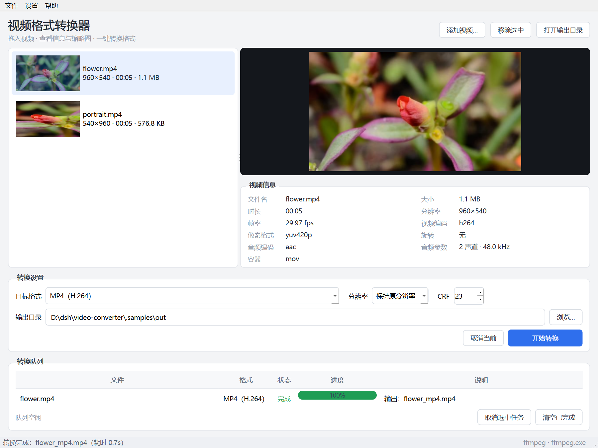

# 视频格式转换器（Video Converter）

Windows 桌面客户端：**PySide6 + 本地 ffmpeg CLI**。拖入视频即可查看信息与缩略图，
按预设转成 MP4 / MKV / WebM / GIF / MP3，支持队列、进度、取消与中文错误提示。

仓库：https://github.com/qianqianying27/video-converter



## 功能

| 功能 | 说明 |
| --- | --- |
| 视频信息 | 容器、时长、分辨率、帧率、视频/音频编码、像素格式、旋转、码率、大小（ffprobe） |
| 缩略图 | 后台线程抽帧，按 10% → 50% → 首帧回退；全部失败显示占位图，不阻塞界面 |
| 转换预设 | MP4（H.264）、MKV（`-c copy` 无损换封装）、WebM（VP9）、GIF、MP3 |
| 参数 | 分辨率（1080p / 720p / 480p / 360p / 原分辨率）、CRF 质量 |
| 进度与取消 | 解析 `-progress pipe:1`，显示百分比、速度、剩余时间；取消会 kill 进程并删除半成品 |
| 队列 | 多文件顺序转换，状态：等待中 / 转换中 / 完成 / 失败 / 已取消；失败给中文原因 |
| 体验 | 拖拽添加、双击打开输出目录、记住窗口几何与上次设置、内置 ffmpeg 优先、可手动指定 |

## 快速开始（Windows）

```powershell
# 1. 获取 ffmpeg / ffprobe 到 bin\（约 170MB，仅首次）
powershell -ExecutionPolicy Bypass -File scripts\fetch_ffmpeg.ps1

# 2. 创建环境并安装依赖
python -m venv .venv
.venv\Scripts\python -m pip install -r requirements.txt

# 3. 运行
.venv\Scripts\python run.py
```

没有 ffmpeg 时程序会弹出提示，也可以直接选择已有的 `ffmpeg.exe`。
如果本机已安装 ffmpeg 并加入 PATH，可跳过第 1 步。

## 测试

```powershell
.venv\Scripts\python -m pytest -q
```

- 单元测试：进度解析、命令行构建、ffprobe JSON 解析（不需要 ffmpeg）
- 集成测试：现场生成 2 秒测试视频，真实执行探测 / 抽帧 / 转 WebM / 缩放 / 抽 MP3 / GIF
- GUI 冒烟：`QT_QPA_PLATFORM=offscreen` 下构造主窗口

## 打包

```powershell
powershell -ExecutionPolicy Bypass -File scripts\build.ps1
```

产物在 `dist\VideoConverter\`（onedir，内含 `bin\ffmpeg.exe`、`bin\ffprobe.exe`）。
把整个目录拷贝给用户即可运行，无需安装 Python。

## 目录结构

```
video-converter/
├─ app/
│  ├─ env.py            # ffmpeg/ffprobe 定位、子进程封装（Windows 无黑框）
│  ├─ media_info.py     # ffprobe 解析 + 展示格式化
│  ├─ thumbnail.py      # 多时间点抽帧回退 + 缓存
│  ├─ presets.py        # 预设与 ffmpeg 参数构建（纯函数，可单测）
│  ├─ progress.py       # -progress 输出解析
│  ├─ converter.py      # 单任务 QProcess（异步 / 取消 / 清理半成品）
│  ├─ queue.py          # 顺序转换队列
│  ├─ settings.py       # QSettings 封装
│  ├─ ui/               # 主窗口 + 后台加载任务
│  └─ main.py           # 入口（缺少 ffmpeg 时引导定位）
├─ bin/                 # ffmpeg.exe / ffprobe.exe（不入库，脚本获取）
├─ tests/               # 单元 + 集成 + GUI 冒烟
├─ scripts/             # fetch_ffmpeg.ps1 / build.ps1 / make_test_video.py
└─ docs/                # 决策记录、截图
```

## 设计说明

关键取舍、踩坑与反馈记录见 [docs/DECISIONS.md](docs/DECISIONS.md)，
开发过程与结论见 [SESSION_SUMMARY.md](SESSION_SUMMARY.md)。

## 已知限制

- 未做时间线剪辑、批量规则引擎、自动更新、账号体系（三天范围外，刻意不做）。
- `MKV（无损换封装）` 使用 `-c copy`：若源编码不被 MKV 支持会失败并给出中文原因，此时请改用 MP4/WebM。
- WebM（VP9）编码较慢，属预期行为；可在后续版本增加硬件编码探测。
- 仅面向 Windows 交付；代码中的命令构建是跨平台的，但打包与 `bin\` 约定按 Windows 处理。
